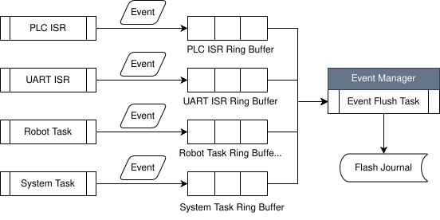
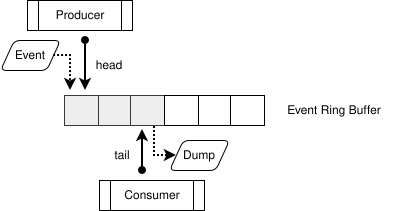

# MCU Diagnostic Framework Design Specification | MCU 診斷框架設計規格書   

  

**Target Platform**: MCU / RTOS-Based Embedded System  
**Applicable Systems**: EFEM Controller、Robot Controller、PLC Gateway、Equipment Controller、Industrial Automation System   

## Introduction | 前言   

Industrial controllers typically operate under severe resource constraints compared with server or desktop systems. Limited RAM, Flash capacity, storage space, CPU performance, and flash endurance make traditional server-style logging architectures impractical. Excessive trace logging may consume valuable system resources, shorten flash lifetime, and negatively impact real-time control performance.   
相較於伺服器或桌面系統，工業控制器通常受到較嚴格的資源限制。有限的 RAM、Flash 容量、儲存空間、CPU 效能以及 Flash 擦寫壽命，使得傳統伺服器式的 Logging 架構難以直接套用。若大量輸出 Trace Log，不僅會消耗寶貴資源，也可能影響即時控制性能與 Flash 壽命。  

For equipment control systems such as EFEM controllers, robot controllers, PLC gateways, and industrial automation devices, the objective of diagnostics is not to preserve every execution detail. Instead, the primary goal is to retain sufficient operational history to reconstruct system behavior before an abnormal event, allowing efficient fault investigation and recovery.   
對於 EFEM Controller、Robot Controller、PLC Gateway 與各類工業設備控制器而言，診斷系統的目標並非保存所有執行細節，而是在異常發生前後保留足夠的系統事件歷程，協助工程師快速還原問題情境並找出根因。   

This document defines an event-based diagnostic framework that combines Event Ring Buffers, Flash Journaling, Runtime Diagnostic Control, CRC protection, power-failure recovery, and wear-leveling mechanisms to provide a reliable and maintainable diagnostic infrastructure.   
本文件定義一套以 Event 為核心的診斷框架，整合 Event Ring Buffer、Flash Journal、動態診斷控制、CRC 保護、掉電復原以及 Wear Leveling 等機制，以建立高可靠度且適合長期維運的 MCU 診斷系統。   

## Design Objectives | 設計目標   

The framework shall satisfy the following objectives:  
本框架應滿足以下目標：   

* Minimize RAM consumption.  
降低 RAM 使用量。  
* Minimize Flash write operations.  
降低 Flash 寫入頻率。   
* Preserve real-time behavior.  
維持即時控制能力。   
* Support field diagnostics.  
提供現場診斷能力。   
* Support power-loss recovery.  
支援掉電後資料復原。   
* Support long-term Flash endurance.  
延長 Flash 使用壽命。   
* Provide sufficient information for root cause analysis.  
提供足夠資訊進行根因分析。   

## Logging Philosophy | 記錄策略   

This framework adopts an event-oriented approach rather than a trace-oriented approach. Continuous trace messages are useful during development but are generally unsuitable for production systems due to resource constraints and performance impact.   
本框架採用 Event-Oriented Design，而非 Trace-Oriented Design。   
Trace Log 雖然有助於開發階段除錯，但在正式產品中通常會造成過多資源消耗與效能負擔。   

Instead of recording every function call or variable update, the framework records significant operational events such as state transitions, alarms, communication failures, startup sequences, and operator actions.   
因此，本架構不記錄每一次函式呼叫或變數變化，而是記錄具有診斷價值的重要事件，例如狀態切換、設備告警、通訊異常、系統啟動流程以及操作指令等。   

## Trace and Diagnostic Architecture | 追蹤 與 診斷 架構   

Although TRACE and DIAG (Diagnostic) messages are often grouped together in many software projects, they serve fundamentally different purposes and should be treated as separate diagnostic layers.   
雖然許多軟體專案會將 TRACE (追蹤) 與 DEBUG (診斷) 視為同一類資訊，但在工業控制系統中，兩者的用途其實完全不同，因此應視為不同層級的診斷資訊。   

TRACE information is intended primarily for software developers during design verification, algorithm validation, performance analysis, and low-level debugging. TRACE messages typically capture execution flow, function entry and exit, state transitions, timing measurements, and internal implementation details.   
TRACE 主要提供軟體開發人員使用，適用於演算法驗證、系統分析、效能分析及程式除錯。TRACE 通常記錄程式執行流程、函式進出、狀態切換、執行時間以及其他內部實作細節。  

Diagnostic information, on the other hand, is intended for field engineers, service personnel, and system integrators. Diagnostic messages provide operational visibility into system behavior without exposing low-level implementation details. They focus on answering operational questions such as system state, equipment status, current mode, active recipe, communication status, and error context.   
Diagnostic（DIAG）則是提供現場工程師、維護人員及系統整合人員使用。DIAG 著重於設備目前的運作狀態，而非程式如何實作。它回答的是設備目前處於什麼狀態、正在執行什麼工作、連線是否正常、是否發生異常等問題。   

For long-life industrial products, TRACE and DIAG should not be considered equivalent and should be managed independently.    
對於生命週期長達十年以上的工業設備產品而言，TRACE 與 DIAG 不應視為相同功能，而應分別管理。   


**Diagnostic Architecture | 診斷架構**

```
Application Tasks
        │
        ▼
Event API
        │
        ▼
Event Ring Buffer
        │
        ▼
Flash Journal
        │
        ▼
Diagnostic Dump Tool
```

### TRACE Layer | TRACE 層   

TRACE is a developer-oriented instrumentation layer. Its primary purpose is to reconstruct software execution paths and analyze timing behavior.  
TRACE 屬於開發人員使用的程式追蹤層（Instrumentation Layer），主要用於還原程式執行路徑及分析執行時序。   

Typical TRACE information includes:  
典型 TRACE 內容包含：   

```
Function Entry | 函式進入
Function Exit | 函式離開 
Task Scheduling | Task 排程
State Machine Transition | State Machine 狀態切換
Execution Duration | 執行時間量測
Protocol Parsing Detail | 通訊協定解析過程
```

TRACE data is usually generated at a very high frequency and may significantly affect CPU utilization, memory consumption, communication bandwidth, and storage usage.   
TRACE 通常具有極高的產生頻率，因此可能大幅增加 CPU 使用率、記憶體消耗、通訊頻寬負載以及儲存空間需求。    

For this reason, TRACE should be enabled only in engineering builds and should not be included in production firmware.   
因此建議 TRACE 僅存在於 Engineering Build，不應納入 Release Build。   

**Example | 範例**   

```
10:01:10.123 Enter RobotMove()
10:01:10.125 Send PLC Signal
10:01:10.130 Wait PLC ACK
10:01:10.150 PLC ACK Received
10:01:10.152 Exit RobotMove()
```

### DIAG Layer | DIAG 層  

DIAG is an operational diagnostic layer designed for production systems. Its primary purpose is to provide enough visibility for troubleshooting while maintaining low resource consumption.   
DIAG 屬於產品運行期間的診斷層，其目標是在不消耗過多資源的情況下提供足夠的問題分析能力。   

Unlike TRACE, DIAG should describe system conditions rather than execution details.   
與 TRACE 不同，DIAG 應描述設備目前的運作狀態，而非程式內部執行細節。   

Typical DIAG information includes:   
典型 DIAG 資訊包括：   

```
Current Robot State | 目前 Robot 狀態
Current Recipe | 目前 Recipe
PLC Mode | 目前 PLC 模式
Current Job | 目前 Job
Connection Status | 目前連線狀態
Alarm Context | 異常脈絡資訊
```

Well-designed DIAG information should remain useful even years after product deployment and should be understandable without access to the source code.   
良好的 DIAG 設計即使在產品上市多年後，仍可提供現場工程師獨立分析問題，而不需要查看原始碼。   

**Example | 範例**   

```
Robot State = MOVING 
Current Recipe = PKG_001 
Current Job = LOT12345 
PLC State = READY
```


### Event Layer | Event 層   

Events provide historical context and record significant system activities. Unlike TRACE and DIAG output, events are intended for long-term retention and post-failure analysis.   
Event 層提供事件歷史紀錄與問題追溯能力。不同於 TRACE 與 DIAG，Event 屬於長期保存資料，主要用於故障分析及事件還原。   

Events should be compact, structured, and suitable for storage in RAM buffers or Flash journals.   
Event 應儘量採用結構化格式並降低儲存空間需求。   

Please refer to the [Event Architecture](#event-architecture--事件架構) for details.    
詳細內容請參考 [事件架構](#event-architecture--事件架構) 。   

### Alarm Layer | Alarm 層   

Alarms represent actionable abnormal conditions requiring operator awareness or intervention.   
Alarm 層代表需要立即被操作人員注意或介入處理的異常狀況。   

Alarm records should always be persistent and survive system reboot.   
Alarm 紀錄應永久保存，並於系統重新開機後仍可查閱。   


**Example | 範例**   

```
PLC Communication Lost 
Robot Motion Timeout 
Configuration Corrupted 
Emergency Stop Triggered
```

### Recommended Layered Architecture | 建議分層架構   

The recommended diagnostic hierarchy is shown below:   
建議採用以下分層架構：   

```
TRACE
Development Only | 開發追蹤
 
DIAG
Runtime Diagnostic | 執行中診斷
 
EVENT
System History | 系統歷程
 
ALARM
Persistent Failure Record | 異常紀錄
```

Each layer serves a different audience and retention requirement.   
各層級服務不同對象與用途：  

* TRACE targets developers.   
TRACE 提供開發人員進行程式分析。   
* DIAG targets field service engineers.  
DIAG 提供現場工程師進行問題診斷。   
* EVENT targets root-cause investigation.   
EVENT 提供故障追溯與根因分析。   
* ALARM targets operators and maintenance personnel.  
ALARM 提供操作員及維護人員執行異常處置。    


### Recommended Storage Strategy | 建議儲存策略   

For resource-constrained MCU systems, the following storage policy is recommended:   
針對 MCU 平台，建議採用以下儲存策略：   

| Layer<br>層級 | ALARM | Event | DIAG | TRACE |
| ---- | ---- | ---- | ---- | ---- |
| [Severity<br>事件等級](#event-severity-architecture--事件等級架構) | WARNING+ | INFO+ | DIAG | TRACE |
| Storage<br>儲存 | Persistent Flash Storage<br>永久保存於 Flash | [RAM Ring Buffer](#ring-buffer-design--ring-buffer-設計)<br>[Flash Journal](#flash-journal--flash-journal-設計) | Runtime Console<br>e.g. UART. | Console Only<br>僅 Console 輸出<br>e.g. stdout. | 
| Note<br>備註 | -- | -- | Optional Event Generation<br>必要時轉換為 Event | Engineering Build Only<br>僅限 Engineering Build | 


The proposed layered diagnostic architecture separates development instrumentation, operational diagnostics, historical event recording, and persistent alarm management into independent subsystems. This separation minimizes resource consumption while maintaining sufficient observability throughout the product lifecycle. By limiting TRACE functionality to engineering environments and relying on DIAG, EVENT, and ALARM mechanisms in production environments, the system achieves an optimal balance between diagnosability, reliability, flash endurance, and runtime performance.   
本分層式診斷架構將開發追蹤（TRACE）、運行診斷（DIAG）、事件歷史（EVENT）與異常管理（ALARM）區分為獨立子系統。此設計可在有限的 MCU 資源下兼顧系統可觀測性與執行效能。透過將 TRACE 限制於研發環境使用，而於正式產品中採用 DIAG、EVENT 與 ALARM 機制，可在診斷能力、系統可靠度、Flash 壽命及即時性能之間取得最佳平衡，並提供完整的產品生命週期維護能力。   

## Event Architecture | 事件架構   

Events represent meaningful system activities. Events should describe what happened rather than how the code executed internally.   
Event 是系統內最基本的診斷單位。Event 應描述「發生了什麼事情」，而非程式如何執行。這類事件具有長期保存價值。  

**Example | 範例**   

```
10:10:01 MOVE_BEGIN
10:10:02 WAIT_PLC_ACK
10:10:04 PLC_TIMEOUT
10:10:04 ALARM_RAISED
```

### Event Structure | 事件資料結構   

The recommended event structure is shown below.   
建議採用固定長度 Event 結構：  

```
typedef struct
{
    uint32_t timestamp;

    uint16_t module_id;
    uint16_t event_id;

    uint8_t severity;
    uint8_t source;

    uint16_t crc16;

    uint32_t arg1;
    uint32_t arg2;

} event_t;
```

固定長度結構有助於 [Ring Buffer 管理](#ring-buffer-design--ring-buffer-設計)、[Flash 儲存](#flash-journal--flash-journal-設計)與 [CRC 驗證](#crc-protection--crc-保護機制)。


### Dump Format | Dump 格式   

**Human Readable**  
```
Time      : 10:00:01.123
Module    : ROBOT
Event     : MOVE_BEGIN
Severity  : INFO
Arg1      : Slot=5
Arg2      : Port=2
```

**CSV**  
```
timestamp,module,event,severity,arg1,arg2 
1000,ROBOT,MOVE_BEGIN,INFO,5,2 
1200,PLC,TIMEOUT,ERROR,3000,0
```

### Event Dictionary | 事件字典設計   

Events are stored as numeric identifiers rather than text strings.   
系統內部僅儲存 Event ID，不直接儲存文字訊息。   

例如：  

```
EVT_SYS_START = 1000
EVT_PLC_TIMEOUT = 2001
EVT_MOVE_BEGIN = 3000
EVT_ALARM_RAISED = 4000
```

透過 Translation Table 轉換為可讀文字。   

### Event Severity Architecture | 事件等級架構   

Please refer to the [Priority and Severity](../Priority.md) for details.    
詳細內容請參考 [重要性權重 與 事件等級](../Priority.md) 。   

### Event Source Definition | 事件來源定義  

The source field records the origin of an event.  
Source 用於記錄事件來源。   

**Example | 範例**   

```
SRC_ISR
SRC_TASK
SRC_DRIVER
SRC_SYSTEM
```

藉此可快速區分事件來自 ISR、Task 或底層 Driver。

## Runtime Dynamic Log Control | 執行階段動態日誌控制

The framework shall support runtime log configuration without requiring firmware updates or device restarts.   
系統應支援執行期間動態調整日誌等級，而不需要重新燒錄韌體或重新啟動設備。   

Field engineers can dynamically increase diagnostic verbosity during troubleshooting and restore normal operation afterward.   
現場工程師可於故障分析期間提高診斷資訊輸出量，待問題排除後再恢復正常設定。  

### Global Log Control | 全域日誌控制

**Example | 範例**   

```
robot_cli log set INFO
```

All modules immediately switch to INFO mode.   
執行後所有模組立即切換至 INFO 等級。   

### Module-Specific Log Control | 模組級別日誌控制   

**Example | 範例**   

```
robot_cli log set TRACE motion
robot_cli log set DEBUG plc
robot_cli log set INFO vision
```
```
robot_cli log set DIAG robot
```

Only the Robot module enters DIAG (Diagnostic) mode.   
只有 Robot 模組進入 DIAG（暫時性診斷）模式，其餘模組維持原設定。   

### Temporary Diagnostic Session | 暫時性診斷模式   

The framework may support automatic timeout and restoration.   
系統建議支援自動恢復機制。   

**Example | 範例**   

```
robot_cli log set DIAG robot 600
```

The setting remains active for 600 seconds before automatically reverting.   
表示 Robot 模組進入 DIAG（暫時性診斷）模式 600 秒，之後自動恢復原設定。   

### Event Recording of Log Changes | 日誌變更事件記錄   

All log-level changes shall themselves be recorded as events.   
所有日誌等級變更都應記錄至 Event Buffer。   

**Example | 範例**   

```
LOG_LEVEL_CHANGED
 
Module = ROBOT
OldLevel = ERROR
NewLevel = DIAG
```

如此可完整追蹤系統診斷行為。   

## Ring Buffer Design | Ring Buffer 設計  

The framework utilizes RAM-based ring buffers to preserve the most recent system history. When the buffer becomes full, the oldest events shall be overwritten.   
系統使用 RAM Ring Buffer 保留最近一段時間的事件紀錄。當 Buffer 滿載時，新事件將覆蓋最舊事件。   

This ensures that the latest events surrounding a failure are always preserved.   
此設計可確保故障發生時能夠保留最近的關鍵事件資訊。   

### ISR and Task Safety Design | ISR 與 Task 安全設計   

In a typical MCU-based controller, events may originate from multiple execution contexts simultaneously. These contexts commonly include interrupt service routines (ISR), application tasks, communication stacks, device drivers, and background services.  
在 MCU 控制器中，事件來源通常不只來自單一執行脈絡，而可能同時來自中斷服務程式（ISR）、應用程式 Task、通訊協定堆疊、裝置驅動程式以及背景服務。   

A direct shared-access design may introduce race conditions, synchronization overhead, timing uncertainty, and increased interrupt latency. Such behavior is particularly undesirable in real-time control systems where deterministic execution is required.  
若所有執行脈絡直接共用同一個 Event Buffer，容易產生競爭條件（Race Condition）、同步成本增加、執行時序不確定以及中斷延遲增加等問題。對於重視即時性的控制系統而言，這些問題都可能影響系統穩定性與控制精度。   

To reduce complexity and improve system predictability, the diagnostic framework should separate ISR-generated events from task-generated events.  
因此，本設計建議將 ISR 事件與 Task 事件分開管理。   

The recommended architecture is shown below:  
建議架構如下：   

   

Under this architecture, ISR routines only post lightweight event records into the ISR Ring Buffer and immediately return control to the processor. More expensive operations such as event formatting, event translation, flash writing, and diagnostic reporting are deferred to background tasks.   
在此架構下，ISR 僅負責快速建立事件紀錄並寫入 ISR Ring Buffer，完成後立即離開中斷服務行程。事件格式化、事件轉換、Flash 寫入及診斷輸出等較耗費資源的工作，則由背景 Task 負責處理。

This approach minimizes interrupt latency and helps maintain deterministic system behavior.   
此設計可有效降低中斷執行時間，並確保系統維持可預測且穩定的即時行為。   

**ISR Event Example | ISR Event 範例**  
```
event_post_isr(
    MOD_PLC,
    EVT_TIMEOUT,
    timeout_ms,
    0);
```

**Task Event Example | Task Event 範例**  
```
event_post(
    MOD_ROBOT,
    EVT_MOVE_BEGIN,
    slot,
    port);
```


### Lock-Free Buffer Strategy | 無鎖定 Buffer 策略   

The diagnostic framework should avoid mutexes and semaphores whenever possible. Although traditional locking mechanisms provide thread safety, they may introduce blocking behavior, priority inversion, timing jitter, and unnecessary context switching.   
本診斷框架建議盡可能避免使用 Mutex 或 Semaphore 等同步機制。  
雖然傳統鎖定機制能夠提供執行緒安全保護，但同時也會帶來阻塞（Blocking）、優先權反轉（Priority Inversion）、執行時序抖動（Jitter）以及額外的 Context Switch 成本。   

For event recording, a lock-free design is generally preferred.   
對於事件記錄系統而言，較建議採用 Lock-Free 設計。   

The recommended implementation uses a Single Producer Single Consumer (SPSC) Ring Buffer whenever possible.   
在大多數情況下，建議使用 Single Producer Single Consumer（SPSC）Ring Buffer。  

Under the SPSC model:   
在 SPSC 架構中：   

* Producer updates only the head pointer.  
Producer 只修改 Head Pointer。
* Consumer updates only the tail pointer.  
Consumer 只修改 Tail Pointer。
* No shared ownership of indices exists.  
雙方不會同時修改同一個索引值。  
* No mutex is required.  
不需要 Mutex 保護。  

Conceptually:  
概念如下：  

   


Because each side modifies only one pointer, synchronization overhead is eliminated.  
由於 Producer 與 Consumer 各自只負責維護單一指標，因此幾乎不需要同步成本。  

**Ring Buffer Structure | Ring Buffer 結構**   
```
typedef struct
{
    volatile uint32_t head;
    volatile uint32_t tail;

    event_t events[EVENT_BUF_SIZE];

} event_ring_t;
```

**Overwrite Strategy | 覆蓋模式**  

For diagnostic systems, dropping new events is usually less desirable than discarding old events.  
對診斷系統而言，通常較不希望遺失最新事件。   

Therefore, overwrite mode is recommended.  
因此建議採用覆蓋模式。   

**Example | 範例**   

```
if (next == rb->tail)
{
    rb->tail =
        (rb->tail + 1) %
        EVENT_BUF_SIZE;
}
```

This ensures that the system always preserves the most recent events surrounding a fault condition.  
當 Buffer 已滿時，自動移除最舊事件，以保留最新事件資訊。   
此設計可以確保系統在異常發生時，仍保有最近一段時間的重要歷程。   

**Why Lock-Free Design is Recommended | 為何建議採用 Lock-Free 設計**   

Lock-free event buffers provide several advantages:  
Lock-Free Event Buffer 可帶來以下優點：   

* No mutex overhead.   
不需要 Mutex。   
* No semaphore latency.   
不需要 Semaphore。   
* Minimal ISR execution time.   
降低 ISR 執行時間。   
* Reduced scheduling jitter.   
減少排程抖動。   
* Improved real-time determinism.   
提升系統即時性。   
* Higher system scalability.   
提升系統可擴充性。   

These benefits are particularly valuable in robot controllers, motion controllers, PLC gateways, and equipment automation systems where predictable execution timing is critical.   
對於 Robot Controller、Motion Controller、PLC Gateway 以及各類設備控制器而言，由於系統對執行時序穩定性有高度要求，因此 Lock-Free Ring Buffer 通常是較佳的實作方式。   

## Flash Journal | Flash Journal 設計   

The Flash Journal subsystem provides persistent storage for diagnostic events and alarms that must survive system restart, firmware update, or unexpected power loss.  
Flash Journal 子系統負責保存需要跨越重新開機、韌體更新及非預期斷電後仍可保留的重要事件與異常紀錄。    

Unlike RAM-based Event Ring Buffers, which only preserve recent runtime activities, Flash Journal provides long-term event retention and historical diagnostics. The journal stores event records in a sequential append-only format and serves as the primary source for post-failure analysis, field troubleshooting, and maintenance investigations.   
與僅保存近期執行紀錄的 Event Ring Buffer 不同，Flash Journal 提供長期事件保存能力，並作為故障分析、現場維護、異常追溯及產品診斷的主要資料來源。   

To maximize Flash lifetime and system reliability, the Flash Journal subsystem shall support:  
為提升系統可靠度並延長 Flash 使用壽命，Flash Journal 應支援：  

* Append-only storage   
Append-Only 寫入模式   
* Page-level CRC protection   
頁面 CRC 保護   
* Event-level CRC protection   
Event CRC 保護   
* Power-loss recovery   
掉電復原機制   
* Bad page management   
壞頁管理   
* Wear leveling
* Boot-time journal reconstruction   
開機重建機制   
* Event export and diagnostic dump   
Event 匯出與診斷分析   

The Flash Journal shall never be accessed directly by application modules. All access shall be managed through the Event Manager to ensure data consistency and recovery integrity.   
所有 Flash Journal 存取皆應透過 Event Manager 統一管理，應用程式模組不得直接存取 Flash Journal，以避免資料一致性問題與復原機制失效。   

### Design Objectives | 設計目標   

The Flash Journal subsystem is designed to satisfy the following requirements:   
Flash Journal 的主要設計目標如下：   

* Preserve critical event history across power cycles.   
保存跨越重新開機後仍需保留的重要事件。   
* Minimize Flash wear caused by high-frequency logging.   
降低高頻事件造成的 Flash 磨損。   
* Maintain data integrity during unexpected power interruption.   
確保非預期掉電時資料仍具完整性。   
* Support diagnostics over the entire product lifecycle.   
支援產品生命週期內的故障分析需求。   
* Provide efficient retrieval of historical event records.   
提供高效率的歷史事件查詢與匯出能力。   

### Flash Memory Layout | Flash 記憶體分配   

The Flash Journal area shall be divided into multiple fixed-size pages.   
Flash Journal 區域應切分為多個固定大小頁面（Page）。   

**Example | 範例**   

```
Flash Journal Area

+--------+
| Page 0 |
+--------+
+--------+
| Page 1 |
+--------+
+--------+
| Page 2 |
+--------+
...
+---------+
| Page 63 |
+---------+
```
Pages are managed as a logical circular journal.   
所有頁面共同組成一個循環式 Journal。   

### Append-Only Strategy | Append-Only 策略   

The Flash Journal shall use an append-only design.   
Flash Journal 應採用 Append-Only 寫入方式。   

New event records are always appended to the current active page. Existing records shall never be modified in place.   
所有新事件皆附加於目前使用中的頁面尾端，不允許直接修改既有資料。   

When the current page becomes full, a new page is allocated and subsequent events are written into the newly selected page.   
當目前頁面已滿時，系統分配新的頁面繼續寫入。   

**Example | 範例**   
```
Page0
  ↓
Page1
  ↓
Page2
  ↓
Page3
```

This design simplifies recovery and significantly reduces Flash wear.  
此設計可大幅簡化復原流程，並降低 Flash 磨損風險。   

### Journal Capacity Management | Journal 容量管理   

The Flash Journal has finite storage capacity. When all available pages have been consumed, the system shall apply a predefined retention policy to determine how new events are stored.   
Flash Journal 的儲存空間有限。當所有可用頁面皆已寫滿時，系統必須依據預先定義的資料保留策略（Retention Policy）決定後續事件的儲存方式。   

The selected policy shall balance diagnostic value, storage availability, and flash endurance requirements.   
選擇何種策略需考量：   

* 診斷價值  
* 可用儲存空間  
* Flash 壽命  
* 產品維護需求  

When journal capacity is exhausted, the Event Journal shall operate in circular mode by reclaiming the oldest valid pages. Critical records such as FATAL events and safety-related alarms should be stored in a separate protected journal area to prevent accidental overwriting. This approach ensures continuous event recording while preserving the most valuable diagnostic information.   
當 Journal 容量耗盡時，Event Journal 應採用循環式管理機制，自動回收最舊的有效頁面並重新使用。對於 FATAL 事件及安全相關 Alarm，則建議儲存於獨立的保護區域，避免被循環覆蓋。透過此設計，可同時兼顧持續記錄能力、Flash 使用效率及關鍵故障資訊保存需求。   

### Page Header | 頁面標頭

Each page shall begin with a page header.   
每個 Flash Page 開頭皆應包含 Page Header。   

```
typedef struct
{
    uint32_t magic;          // "EVNT"
    uint32_t sequence;       // Page Sequence
    uint32_t timestamp;      // First Event Timestamp
    uint16_t event_count;
    uint16_t status;         // WRITING/VALID/BAD
    uint32_t erase_count;    // Wear Leveling
    uint32_t crc32;

} page_header_t;
```

**Field Definitions | 欄位定義**   

**magic**   

The `magic` field identifies the page format and serves as the first validation mechanism during journal scanning and recovery operations. It allows the system to determine whether a Flash page contains a valid Event Journal record or uninitialized, corrupted, or unrelated data.  
`magic` 欄位用於識別頁面格式，並作為 Journal 掃描與復原流程中的第一道驗證機制。透過 Magic Number，系統可判斷目前頁面是否屬於有效的 Event Journal 資料，或是尚未初始化、已損毀、或屬於其他用途的資料區塊。   

During system startup, the Event Manager shall verify the magic value before processing any page content. If the magic value does not match the expected signature, the page shall be treated as invalid and excluded from journal reconstruction.  
系統開機時，Event Manager 應優先驗證 Magic 值，只有符合預期格式的頁面才允許進一步解析。若 Magic 值不符，則該頁面應視為無效頁面並排除於 Journal 重建流程之外。   

The magic value also provides an additional safeguard against incomplete writes caused by unexpected power loss.  
此外，Magic Number 亦可協助識別因非預期掉電、寫入中斷或記憶體損毀所產生的異常資料。  

Example | 範例   

```
#define EVENT_PAGE_MAGIC 0x45564E54
```

**sequence**   

The `sequence` field records the logical write order of journal pages and provides the primary mechanism for determining page chronology.   
`sequence` 欄位用於記錄 Journal 頁面的邏輯寫入順序，並作為判斷頁面新舊的重要依據。   

Whenever a new page is allocated, its sequence number shall be incremented from the most recently committed page. During startup recovery, the page with the highest valid sequence number is considered the newest page in the journal.   
每當系統分配新頁面時，Sequence 值應由上一個有效頁面持續遞增。系統重新開機後，可透過比較所有有效頁面的 Sequence 值，快速找出最新頁面與下一個可寫入頁面。   

Unlike timestamps, sequence numbers are monotonically increasing and are not dependent on RTC availability, time synchronization, or clock accuracy. Therefore, journal reconstruction and recovery procedures should rely primarily on sequence numbers rather than timestamps when determining page order.   
相較於 Timestamp，Sequence 不依賴 RTC、時間同步機制或系統時鐘，因此不會受到時鐘重設、RTC 電池失效或時間校正錯誤的影響。   
因此，Flash Journal 的 Recovery 流程應優先依據 Sequence，而非 Timestamp，作為頁面排序與重建依據。  

Example | 範例   

```
Page0 Sequence = 100
Page1 Sequence = 101
Page2 Sequence = 102
```

Recovery：
```
Latest Page = Page2
Next Write Page = Page3
```

**timestamp**   

The `timestamp` field records the timestamp of the first event stored within the page.  
`timestamp` 欄位記錄該頁面第一筆事件的時間資訊。   

This information is primarily intended for human-readable diagnostics, event analysis, timeline reconstruction, and maintenance investigations. It enables service engineers to correlate journal data with external system events, alarms, production logs, or operator activities.   
此欄位主要用於事件分析、時間軸重建、故障調查以及維護記錄顯示。透過 Timestamp，工程師可將 Journal 內容與設備告警、生產紀錄或操作紀錄進行時間關聯分析。   

Timestamp information should not be used as the primary ordering mechanism during journal recovery.   
由於 Timestamp 可能受到 RTC 重設或時間校正影響，因此不建議作為 Journal Recovery 的主要排序依據。   

Example | 範例   

```
Timestamp = 2026-10-21 09:31:05
```

**event_count**   

The `event_count` field records the total number of valid event records contained within the page.   
`event_count` 欄位記錄該頁面所包含的有效事件數量。   

This value allows the Event Manager to determine page utilization, validate journal consistency, and accelerate event traversal during journal reconstruction and data export operations.    
系統可利用此資訊快速判斷頁面使用狀況、驗證 Journal 完整性，並在重建索引、事件搜尋或資料匯出時提升處理效率。   

**status**   

The `status` field indicates the lifecycle state of a journal page.   
`status` 欄位用於描述目前頁面的生命週期狀態。   

The status value is used during startup recovery, power-loss recovery, and bad-page management.   
該欄位將被應用於開機復原、掉電保護及壞頁管理等機制。   

Supported values are:   
支援狀態如下：   

```
WRITING
VALID
BAD
```

Where:  
說明如下：   

`WRITING` indicates that page programming is currently in progress.   
`WRITING`：表示頁面正在寫入中，尚未完成。   

`VALID` indicates that the page has been completely written and CRC verification has passed.   
`VALID`：表示頁面寫入完成，且已通過 CRC 驗證。   

`BAD` indicates that the page is permanently unusable due to corruption or Flash failure.   
`BAD`：表示頁面已損毀或 Flash 發生異常，不得再次使用。   

**erase_count**   

The `erase_count` field records the cumulative erase cycles experienced by the page.   
`erase_count` 欄位記錄該頁面的累積擦除次數。   

This information is used by the Wear Leveling subsystem to distribute write and erase operations evenly across all journal pages. By tracking erase counts, the system can avoid repeatedly using the same Flash blocks and significantly extend overall Flash lifetime.   
此資訊主要由 Wear Leveling 機制使用，以平均分配寫入與擦除操作，避免少數 Flash 區塊過度磨損，進而延長整體 Flash 使用壽命。   
系統分配新頁面時，應優先選擇擦寫次數較少的頁面，以降低局部區域老化的風險。   

**crc32** 

The `crc32` field protects the integrity of the entire page and serves as the final validation mechanism during recovery operations.   
`crc32` 欄位用於保護整個頁面的資料完整性，並作為 Recovery 流程中的最後一道驗證機制。   

The CRC shall be calculated over the page header and all event records contained within the page. Any page failing CRC verification shall be considered corrupted and excluded from recovery.   
CRC32 應涵蓋整個 Page Header 與所有 Event 資料。若頁面 CRC 驗證失敗，則代表資料可能遭受毀損或寫入不完整，系統應將該頁面視為無效資料。   

Page-level CRC protection complements Event-level CRC protection to provide multi-layer data integrity verification.   
Page CRC 與 Event CRC 共同構成雙層保護機制，可同時偵測單筆事件錯誤與整頁資料錯誤。   

### Event Flush Policy | Event Flush 策略

Events should not be written directly to Flash whenever they are generated.   
事件產生時不應立即寫入 Flash。   

Instead, events are first stored in RAM buffers and periodically flushed to Flash.   
建議先保存於 RAM Buffer，再由背景 Task 定期寫入 Flash。   

Typical flush conditions include:   
建議 Flush 條件如下：   

* Buffer occupancy exceeds 75%  
Buffer 使用率超過 75%  
* Periodic timer expiration  
固定時間週期到達   
* ERROR event occurrence  
發生 ERROR 事件   
* FATAL event occurrence  
發生 FATAL 事件   
* Controlled system shutdown  
系統正常關機   

如此可大幅降低 Flash 寫入頻率。

### CRC Protection | CRC 保護機制  

Two layers of CRC protection are recommended.   
Event-level CRC16 protects [individual records](#event-structure--事件資料結構) while page-level CRC32 protects entire storage pages.   

建議採用雙層 CRC 保護機制。  
第一層使用 CRC16 保護[單筆 Event](#event-structure--事件資料結構)。  
第二層使用 CRC32 保護整個 Flash Page。  
如此可同時偵測單筆事件損毀與整頁資料錯誤。   

### Power Loss Recovery | 掉電復原   

To prevent incomplete page corruption caused by sudden power loss, all page writes shall follow a two-phase commit procedure.   
為避免寫入過程中因突然斷電導致頁面損毀，所有頁面寫入皆應採用兩階段commit （Two-Phase Commit）。   

Write sequence:   
寫入流程：   

```
Status = WRITING
      ↓
Write Events
寫入 Event
      ↓
Compute CRC
計算 CRC32
      ↓
Status = VALID
```
Only pages marked VALID shall be considered recoverable.  
只有狀態為 VALID 的頁面才能於開機後使用。   

### Boot Recovery | 開機復原   

During startup, the Event Manager shall scan all Flash pages and rebuild journal state.   
系統開機時，Event Manager 應重新掃描所有 Journal 頁面，並重建事件索引。   

Validation order:   
驗證順序：   

```
Magic Check
   ↓
Status Check
   ↓
CRC Check
   ↓
Sequence Check
```

Only pages passing all validation checks shall be restored.   
只有全部驗證通過的頁面才允許載入。   

### Bad Page Management | 壞頁管理   

Flash pages exhibiting erase failures, write failures, or ECC errors shall be marked `BAD` and removed from future allocation.   
若頁面發生擦除失敗、寫入失敗或 ECC Error，應立即標記為 `BAD`，後續寫入流程不得再次使用該頁面。   

### Wear Leveling Strategy | 磨損分級策略   

Each page maintains an erase counter. The allocator should prefer pages with lower `erase_count` to distribute wear evenly.   
每個頁面應維護擦寫次數統計。系統應優先使用 `erase_count`（擦寫次數）較低的頁面，以平均消耗 Flash 壽命。  

### Event Export and Diagnostics | Event 匯出與診斷   

The Flash Journal shall support exporting events in both human-readable and machine-readable formats.   
Flash Journal 應支援事件匯出功能，以利現場維護及故障分析。   

Supported formats include:   
建議支援：   

```
Human Readable
CSV
Binary Dump
```

This capability enables field diagnostics and long-term failure analysis.  
透過事件匯出機制，工程師可重建故障前後的完整事件歷程，並作為問題分析與改善依據。   

Please refer to the [Dump Format](#dump-format--dump-格式) for details.    
詳細內容請參考 [Dump 格式](#dump-format--dump-格式) 。   


## Conclusion | 結論  

For MCU-based industrial controllers, a traditional high-volume logging system is neither efficient nor sustainable. An event-driven diagnostic framework combined with lock-free buffering, flash journaling, runtime diagnostic control, CRC protection, power-loss recovery, and wear-leveling provides a significantly more reliable and maintainable solution.   

對 MCU 型工業控制器而言，大量 Trace Log 並非最佳選擇。以 Event 為核心的診斷架構，搭配 Lock-Free Ring Buffer、Flash Journal、Runtime Diagnostic Control、CRC 保護、掉電復原以及 Wear Leveling 機制，能以更低的資源消耗提供更高價值的故障分析能力。  
此架構特別適合 EFEM Controller、Robot Controller、PLC Gateway 與各類工業設備控制系統，可作為產品級診斷框架的設計基礎。  

---

# License｜授權條款

  
MCU Diagnostic Framework Design Specification © 2026 by Jen Yuan Pan is licensed under the `Creative Commons Attribution-NonCommercial-ShareAlike 4.0 International`.  
MCU 診斷框架設計規格書 © 2026 作者 潘貞元（Reta Pan），採用 `Creative Commons 姓名標示－非商業性－相同方式分享 4.0 國際版` 授權。  

For the complete license terms, rights and obligations, restrictions on use, and other applicable conditions, please refer to the [Full License Terms](https://github.com/retamotome/AgileSoftwareProjectGuide/blob/main/LICENSE.md). By using this work, you acknowledge that you have read, understood, and agree to comply with such terms.  
詳細授權內容、權利義務、使用限制及其他相關條件，請參閱《[完整授權條款](https://github.com/retamotome/AgileSoftwareProjectGuide/blob/main/LICENSE.md)》。您使用本作品，即表示已充分閱讀、確已知悉並同意遵守該等條款與規定，並承認其具有法律約束力。     

---

> [!note]  
> **AI Translation Notice | AI 翻譯說明**  
> The Chinese content of this document has been generated through AI-based translation and is presented using Traditional Chinese characters and terminology commonly used in Taiwan to ensure clarity, localization, and readability.  
> 本文之中文內容係由人工智慧（AI）翻譯產出，並採用正體中文及台灣常用語彙進行表述，以確保內容符合在地語言之使用與閱讀習慣。  
