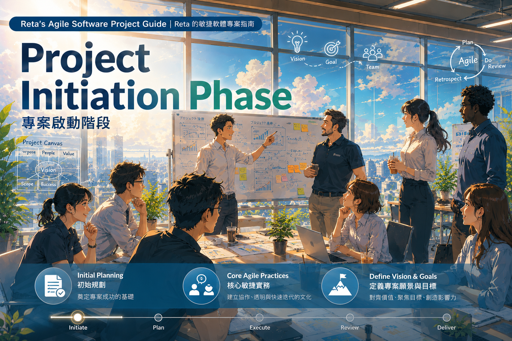

# 軟體安全管理施行細則<br>Software Security Management Implementation Guidelines    

  

***

## 目的 | Purpose   

本文件用於規範軟體開發過程中之資訊安全實務作業，確保開發環境、套件使用與部署流程符合公司資安要求，並有效降低供應鏈攻擊、惡意套件及憑證外洩風險。   
 This document establishes information security practices for software development activities to ensure that development environments, dependency usage, and deployment processes comply with corporate security requirements, while effectively reducing the risks of supply chain attacks, malicious packages, and credential leakage.  

***

## 適用範圍 | Scope   

適用於所有參與軟體開發、測試、建置與部署之人員，包含內部員工、外包人員與合作夥伴。  
 These guidelines apply to all personnel involved in software development, testing, build processes, and deployment activities, including internal employees, contractors, and business partners.   

***

## 開發環境安全管理 | Development Environment Security Management   

### 軟體與套件使用規範 | Software and Dependency Usage Requirements   

所有開發相關軟體、工具、套件與服務得符合以下原則：  
All development-related software, tools, dependencies, and services should comply with the following principles:  

* 僅可使用經資訊部門核准之軟體版本  
Only software versions approved by the IT department may be used.  
* 套件來源必須為官方發布（官方封閉部署的 Repository，如 Ubuntu）  
Packages must be obtained from official distribution sources (such as officially maintained repositories, e.g., Ubuntu repositories).  
* 應具備明確之安全政策與隱私政策文件  
Products and services should provide clearly documented security and privacy policies.  
* 優先選用具備國際資安認證之產品（如 ISO 27001、SOC 2）  
Preference should be given to products with internationally recognized security certifications (e.g., ISO 27001, SOC 2).  
* 開發工具之擴充套件（Extension / Plugin）須為官方發布版本  
Extensions and plugins for development tools must be officially published versions.  

未列於核准清單之軟體、工具、套件與服務，得完成審查流程，並提供：  
Software, tools, dependencies, and services not listed in the approved inventory must undergo a review process and provide:  

  * 使用授權條款  
    License Agreement  
  * 服務條款  
    Terms of Use / Service  
  * 隱私政策   
    Privacy Policy  
  * 第三方授權聲明（如有第三方依賴項目）   
    Third-party License Declarations (if applicable)   

***

### 依賴套件與安裝安全 | Dependency and Installation Security   

#### 標準作業流程 | Standard Operating Procedure   

* 初始化專案時，依據資訊部門核准之軟體版本，立即建立版本鎖定檔（Lock File）   
When initializing a project, immediately create a dependency lock file based on IT-approved software versions.   
* 僅允許透過鎖定檔安裝套件   
Dependencies must be installed only through the lock file.   
* 禁止直接安裝最新版本   
Direct installation of the latest package versions is prohibited.   

#### 建議實務 | Recommended Practices   

**Node.js**

```bash
npm config set ignore-scripts true
npm ci
```

**Python**

```bash
pip install -r requirements.lock
```

#### 安全檢查要求 | Security Verification Requirements   

* 安裝過程不得出現異常 Log   
No abnormal logs should appear during installation.   
* 不得產生非預期對外連線   
No unexpected outbound network connections should occur.   
* 若出現以下情況，應立即停止：   
Installation must stop immediately if any of the following occur:   
  * install script 嘗試執行 Shell 指令   
    An installation script attempts to execute shell commands.   
  * 下載未知來源檔案   
    Files are downloaded from unknown sources.   
  * 存取系統敏感路徑   
    Sensitive system paths are accessed.


***

### 敏感資料管理 | Sensitive Data Management   

應遵循「不落地存放」原則：   
The principle of "No Local Storage of Secrets" must be followed:   

* 禁止於**本機**儲存任何密碼、金鑰、Token 或憑證   
Storing passwords, keys, tokens, or certificates on **local** devices is prohibited.   
* 禁止於**程式內**寫入任何密碼、金鑰、Token 或憑證  
Hardcoding passwords, keys, tokens, or certificates **in source code** is prohibited.  
* 必須使用環境變數或秘密管理系統   
Environment variables or secret management systems must be used.  
* 優先採用短效憑證（Temporary Credential）   
Temporary credentials should be preferred whenever possible.  
* 禁止使用以下預設憑證位置：   
Default credential storage locations listed below must not be used.  
```
~/.aws
~/.kube
~/.ssh
```

***

### 開發環境隔離 | Development Environment Isolation   

所有開發作業須於隔離環境中執行：   
All development activities must be performed in isolated environments:   
* 建議使用 Docker Container 或虛擬機（VM）   
Docker containers or virtual machines (VMs) are recommended.   
* 禁止在主機作業系統直接操作未隔離套件   
Unisolated dependencies must not be executed directly on the host operating system.   
* Python 開發需使用虛擬環境   
Python development must use virtual environments.   

```bash
python -m venv .venv
```

***

### 安全檢測與發布控管 | Security Scanning and Release Control   

#### 標準開發流程（DevSecOps）| Standard Development Process (DevSecOps)  

```
需求 → 設計 → 開發 → Commit → PR → CI → 安全檢查 → Release
Requirements → Design → Development → Commit → PR → CI → Security Review → Release

               ↓          ↓          ↓
             SCA    Secret Scan   Security Gate
```
SCA: 軟體組成分析 Software Composition Analysis   

***

#### 必要檢查項目 | Required Security Checks  

| 類型 Category         | 工具建議 Recommended Tools                  |
| ---------- | ---------------------- |
| 套件風險（SCA）<br>Package Risk (SCA)  | Snyk / BlackDuck       |
| Secrets 掃描<br>Secrets Scanning | GitGuardian            |
| 程式碼分析<br>Code Analysis      | SonarQube              |
| 開源依賴<br>Open Source Dependencies       | OWASP Dependency-Check |

***

#### Release 阻擋條件 | Release Blocking Conditions   

以下情況不得發布：   
Release must be blocked under the following conditions:   

* 存在 High / Critical 漏洞   
High or Critical vulnerabilities exist.   
* 出現未授權套件   
Unauthorized dependencies are detected.   
* 發現憑證外洩   
Credential leakage is identified.   
* 安全掃描未完成   
Security scanning has not been completed.   

***

#### CI/CD 控制範例 | CI/CD Control Example   

```yaml
- name: Security Scan
  run: snyk test --severity-threshold=high

- name: Block Risk Build
  if: failure()
  run: exit 1
```

***

## OT / EFEM / 機械手臂安全控制<br>OT / EFEM / Robot Security Controls  

針對設備控制環境，須額外實施以下控管：   
Additional controls must be implemented for equipment control environments:  


| 控制項目<br>Control Item    | 控制要求<br>Requirement                 | 實務說明<br>Purpose   |
| ------- | -------------------- | ------ |
| 設備網路隔離<br>Network Segmentation  | EFEM 與 IT 網路分離<br>Separate EFEM and IT networks       | 防止橫向滲透<br>Prevent lateral movement |
| 控制程式完整性<br>Program Integrity | 程式需簽章或 hash 驗證<br>Code signing or hash verification       | 防止篡改<br>Prevent tampering   |
| 外部媒體管控<br>Removable Media Control  | 禁止 USB 使用<br>USB devices prohibited            | 防止惡意帶入<br>Prevent malware introduction |
| 套件白名單<br>Package Whitelisting   | OT 環境使用 offline repo<br>Offline repositories for OT environments | 避免外部下載<br>Avoid external downloads |
| 權限控管<br>Access Control    | Robot / PLC 限權<br>Restricted Robot / PLC privileges       | 防止濫用<br>Prevent misuse   |
| 即時監控<br>Real-time Monitoring    | 建立異常行為警示<br>Abnormal behavior alerts             | 提升偵測能力<br>Improve threat detection |

***

### 關鍵風險提醒 | Critical Risk Reminders   

* 不可直接將 CI/CD 結果部署至機台  
CI/CD outputs must not be deployed directly to production equipment.  
* 必須經過模擬或 Staging   
Deployment must first pass simulation or staging validation.   
* 所有控制程式需可追溯版本   
All control software versions must be traceable.  

***

## 資安事件應變流程 | Security Incident Response Process   

### 立即處置 | Immediate Actions

* 停止使用開發環境與工具  
Stop using the development environment and tools.   
* 停止所有套件安裝與 CI 任務  
Stop all package installations and CI jobs.

### 隔離系統 | System Isolation   

* 中斷所有網路連線（Wi-Fi / LAN）   
Disconnect all network connections (Wi-Fi / LAN).   

### 通報處理 | Incident Reporting   

* 通報直屬主管與資訊部門   
Notify the direct supervisor and IT department.   

### 帳號與憑證處理 | Account and Credential Management   

* 撤銷所有 Token（Git、API、Cloud）   
Revoke all tokens (Git, API, Cloud).   
* 更換所有帳號密碼與金鑰   
Rotate all credentials and keys.   

### 環境復原 | Environment Recovery   

重新安裝系統或建立新環境（VM）   
Reinstall the system or provision a new environment (VM).   

### 影響分析 | Impact Assessment   

* 檢查最近 Commit   
Review recent commits.   
* 檢查 CI/CD Pipeline   
Review CI/CD pipelines.   
* 確認是否已影響產品或客戶   
Determine whether products or customers have been affected.   

***

## 安全風險認知 | Security Risk Awareness   

### 觀念說明 | Key Concepts

* 安裝套件等同執行第三方程式   
Installing a package is equivalent to executing third-party code.   
* 內網環境仍可能透過套件來源遭入侵   
Internal networks can still be compromised through package sources.   
* Code Review 無法完全防範供應鏈攻擊   
Code reviews alone cannot fully prevent supply chain attacks.   

### 供應鏈攻擊重點說明 | Supply Chain Attack Overview   

供應鏈攻擊通常透過合法套件進入系統，其特性包括：   
Supply chain attacks commonly enter systems through seemingly legitimate software packages and may:   

* 利用開發流程執行惡意程式   
Execute malicious code during the development process.   
* 將後門植入正式版本   
Implant backdoors into production releases.   
* 影響範圍擴及公司與客戶   
Impact both the organization and its customers.   

Reference | 參考資訊:  
* [從 NPM 憑證竊取到 GitHub Actions 惡意腳本：剖析 CI/CD 流水線供應鏈攻擊手法與防禦策略](https://www.dreamjtech.com/25250/)   
* [Postmortem: TanStack npm supply-chain compromise](https://tanstack.com/blog/npm-supply-chain-compromise-postmortem)  
* [Supply Chain Attack Affecting Numerous npm and PyPI Packages](https://digital.nhs.uk/cyber-alerts/2026/cc-4781)  
* [New Shai-Hulud malware wave compromises 600 npm packages](https://www.bleepingcomputer.com/news/security/new-shai-hulud-malware-wave-compromises-600-npm-packages/)


***

## 遵循與管理要求 | Compliance and Governance Requirements

* 所有人員需確實遵循本施行細則   
All personnel must comply with these guidelines.   
* 違反規範將依公司制度進行處理   
Violations will be handled according to company policies.   
* 資訊部門有權進行稽核與抽查   
The IT department reserves the right to conduct audits and inspections.  


---

# License｜授權條款

     
Software Security Management Implementation Guidelines © 2026 by Jen Yuan Pan is licensed under the `Creative Commons Attribution-NonCommercial-ShareAlike 4.0 International`.   
軟體安全管理施行細則 © 2026 作者 潘貞元（Reta Pan），採用 `Creative Commons 姓名標示－非商業性－相同方式分享 4.0 國際版` 授權。  

For the complete license terms, rights and obligations, restrictions on use, and other applicable conditions, please refer to the [Full License Terms](https://github.com/retamotome/AgileSoftwareProjectGuide/blob/main/LICENSE.md). By using this work, you acknowledge that you have read, understood, and agree to comply with such terms.  
詳細授權內容、權利義務、使用限制及其他相關條件，請參閱《[完整授權條款](https://github.com/retamotome/AgileSoftwareProjectGuide/blob/main/LICENSE.md)》。您使用本作品，即表示已充分閱讀、確已知悉並同意遵守該等條款與規定，並承認其具有法律約束力。    

---

> [!note]  
> **AI Translation Notice | AI 翻譯說明**  
> The English content of this document has been generated through AI-based translation.  
> 本文之英文內容係由人工智慧（AI）翻譯產出。  